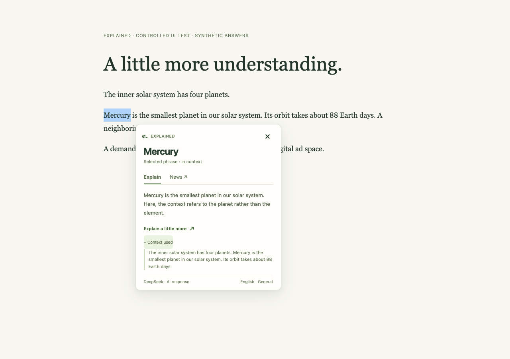

# Explained

**Highlight a phrase. Understand it in context. Keep reading.**

I built Explained for a very simple reason: I kept reading things I didn’t understand.

Working as an analyst in venture capital and private equity meant a lot of reading and a lot of learning. New industries, unfamiliar concepts, and acronyms that seemed to assume we’d already met. There was always something to look up.

AI helped enormously. But keeping an eye on an extension’s quota got old fast, and the tools I tried often came with more features than I wanted. My wish list was pretty short: **explain this bit, please. Let me get back to reading.**

So I made my own. A little Chrome extension, built around my preference for keeping things simple: highlight a phrase, choose Explain, get an explanation beside it, carry on. If curiosity takes you further, there’s a News tab too.

I’m now an independent developer and enterprise AI consultant, and I’m sharing Explained for people with the same reading habits—and the same “hang on, what does that mean?” moments.

This version uses the DeepSeek website in your browser; no official paid API key is required. DeepSeek’s own usage limits still apply.

**Still a work in progress:** v0.1.3 is an experimental preview. There are rough edges, and the connection details and validation limits are documented below.



*UI demonstration with a synthetic answer. This is not a live DeepSeek result or a latency measurement.*

## A little help, right beside your reading

- **Explain it:** highlight a word or phrase, choose **Explain selection**, and read the answer as it arrives. Ask for a little more when you’re curious.
- **Read the room:** nearby sentences help distinguish meanings. You can inspect that context or switch sharing off.
- **Follow the story:** the News tab looks for up to three developments from the past 30 days. Links appear only when returned URLs or explicit citation numbers match structured search metadata; unmatched stories are labeled unverified.
- **Make yourself comfortable:** choose a compact note, split card, or reading margin.
- **Pick your language:** English, Simplified Chinese, or Traditional Chinese.
- **Take a break:** pause everywhere or on a particular site. Your preferences stay saved.
- **Change your mind:** a new selection cancels the old request, so its answer won’t turn up late and steal the spotlight.

Normal HTML webpages in the top frame are supported. Browser pages, restricted store pages, PDFs, input fields, and document editors are outside this preview’s scope. Chrome 114+ is required; other browsers have not been verified.

## Try it in Chrome

1. Download this repository using **Code → Download ZIP**, or clone it:

   ```sh
   git clone https://github.com/yiqin-CodeWizard/explained.git
   ```

2. Extract the ZIP if needed. In `chrome://extensions`, enable **Developer mode**, choose **Load unpacked**, and select the **explained-extension** folder containing `manifest.json`.
3. Pin Explained in Chrome’s Extensions menu. In its toolbar panel, review the sharing notice and choose **Enable lookups**. Enabling alone sends no text and does not open DeepSeek.
4. Refresh an existing reading page and highlight a phrase. Review the local preview, then choose **Explain selection** when you want to send it. For news, select **News** and choose **Search news**. Highlighting and switching tabs never submit text.
5. If a connection needs attention, choose **Open DeepSeek**. Return to your reading and choose **Retry** when ready. Returning never submits automatically. Keep the DeepSeek tab open while answering; it can stay in the background.

No build step is required. For updates, replace the source, reload the extension, refresh reading pages, and close the old dedicated connection tab. Detailed controls and troubleshooting are in the [extension guide](explained-extension/README.md).

## A quick word about your data and the connection

Explained sends your selected phrase and, when enabled, up to 600 characters of nearby context to DeepSeek only after you choose an explicit lookup action. The card exposes the context used. DeepSeek may retain the resulting chats. Explained stores preferences locally and keeps a temporary connection-tab ID; it does not persist lookup history or export your login credentials.

Automatic highlighting requires permission to run on HTTP/HTTPS pages. You can pause a site or restrict site access using Chrome’s extension settings. See [PRIVACY.md](PRIVACY.md) for the data flow and permissions.

This preview uses the website’s internal POST/SSE interface and downloads the site’s official proof-of-work WASM at runtime. It does not bypass sign-in, interactive verification or rate-limit rejection, retry rejected requests automatically, or fall back to website UI submission.

That interface is undocumented and can change. Live News citation mapping and this build’s installed-account behavior still need validation. Explained is an independent project, with no affiliation with DeepSeek or Google.

Public distribution needs a separate review of [DeepSeek’s terms](https://cdn.deepseek.com/policies/en-US/deepseek-terms-of-use.html?locale=de) and [Chrome’s remote-code/WASM policy](https://developer.chrome.com/docs/extensions/develop/migrate/remote-hosted-code). A source-code license does not grant rights to a third-party service. This repository is not a claim of Chrome Web Store eligibility.

## Want to tinker?

Pull up a chair. The extension itself loads without a build step; the tools below are for working on it.

Requirements: Node.js 22+ and Python 3.9+ for development tooling. The loaded extension has no npm dependencies.

```sh
npm ci
npm test
npx playwright install chromium
npm run test:ui
npm run package
```

For an existing Chrome executable, set `CHROME_EXECUTABLE_PATH` when running the UI test. Otherwise, Playwright uses its managed Chromium.

Edit `explained-extension/reader.css` for card styles. Packaging regenerates `reader-styles.js`, validates resources, and creates `explained-v0.1.3.zip` with a SHA-256 checksum. ZIP files and local validation output are ignored by Git.

The test suite includes 23 contract/bridge/decoder tests and 50 controlled browser UI checks. All use controlled responses. The browser test runs the shipped UI scripts on localhost in a temporary profile; it does not install the extension or access an authenticated DeepSeek account. See [validation details](docs/VALIDATION.md) for evidence and remaining live checks.

## Tell me what you think

I thrive on feedback. If something feels clunky, an explanation misses the point, or you have an idea that would make reading easier, [open an issue](https://github.com/yiqin-CodeWizard/explained/issues). Tell me what you were trying to do and what got in the way. Those comments help shape what I build next.

I’m actively iterating on Explained, with a soft spot for improvements that make it simpler. Sometimes the best feature request is “could this take one fewer click?”

Code contributions, accessibility improvements, website compatibility fixes and tests are welcome too. Start with [CONTRIBUTING.md](CONTRIBUTING.md). Please keep account credentials, authentication headers and private chats out of issues and pull requests.

See [the roadmap](docs/ROADMAP.md) and [changelog](CHANGELOG.md) for the current scope. [Security concerns](SECURITY.md) should be reported privately.

## License

[MIT](LICENSE) for the code and project-authored assets. DeepSeek’s service, names, and remotely loaded assets remain subject to their own terms; see [THIRD_PARTY_NOTICES.md](THIRD_PARTY_NOTICES.md).
