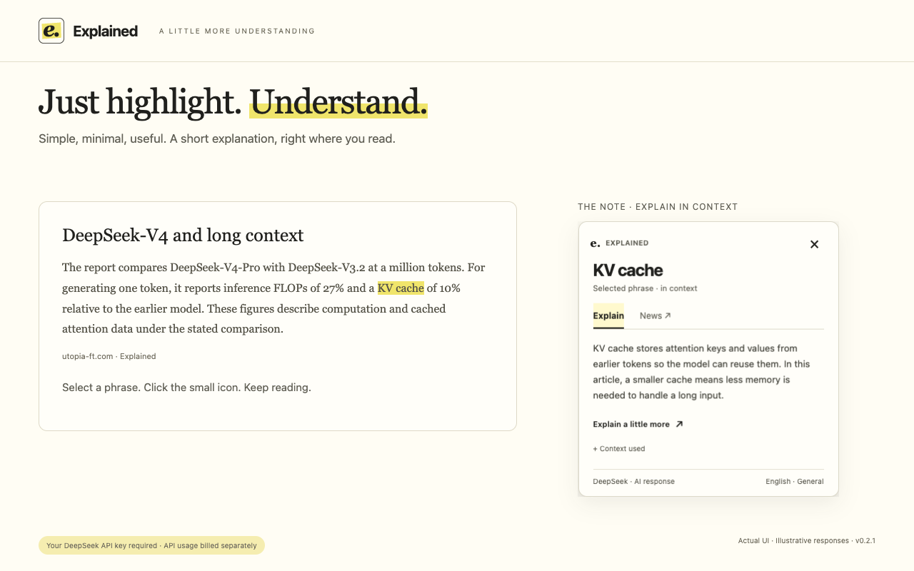
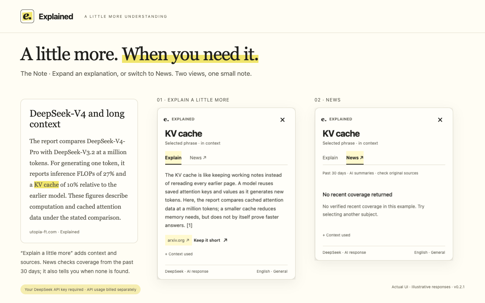
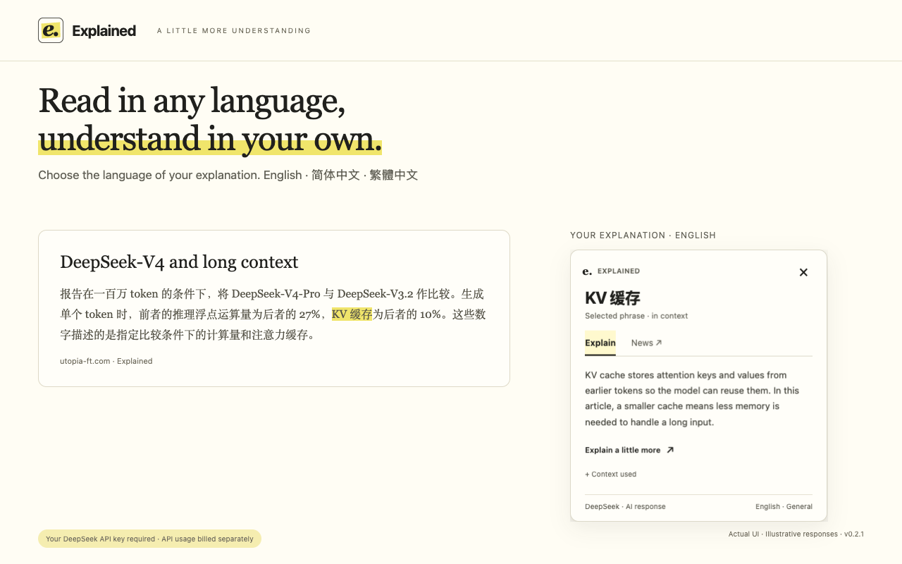
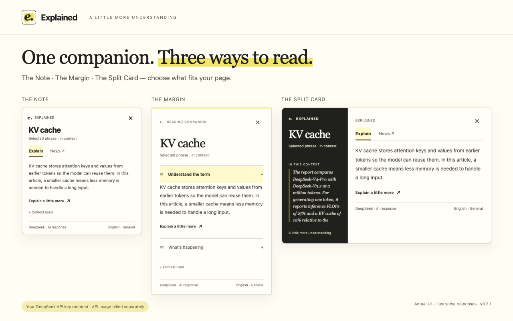
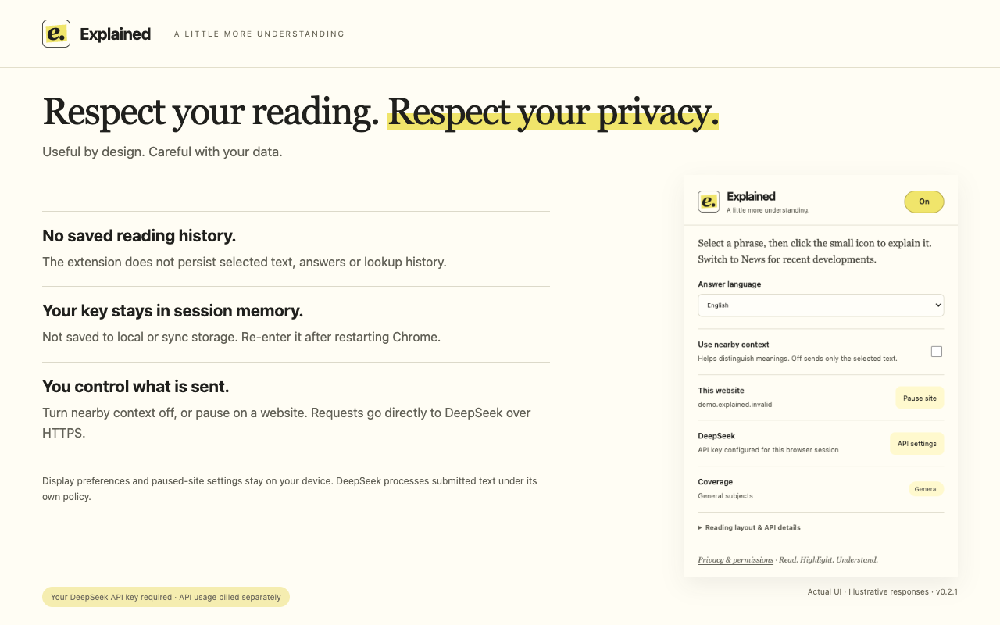

# Explained

**Highlight a phrase. Understand it in context. Keep reading.**

[Official website](https://www.utopia-ft.com/) · [Download & setup](https://www.utopia-ft.com/download/) · [Reading guides](https://www.utopia-ft.com/guides/) · [Privacy policy](https://www.utopia-ft.com/privacy.html)

I built Explained for a very simple reason: I kept reading things I didn’t understand.

Working as an analyst in venture capital and private equity meant a lot of reading and a lot of learning. New industries, unfamiliar concepts, and acronyms that seemed to assume we’d already met. There was always something to look up.

AI helped enormously. But keeping an eye on an extension’s quota got old fast, and the tools I tried often came with more features than I wanted. My wish list was pretty short: **explain this bit, please. Let me get back to reading.**

So I made my own. A little Chrome extension, built around my preference for keeping things simple: highlight a phrase, get an explanation beside it, carry on. If curiosity takes you further, there’s a News tab too.

I’m now an independent developer and enterprise AI consultant, and I’m sharing Explained for people with the same reading habits—and the same “hang on, what does that mean?” moments.

## The current version

The current public download is **Explained API edition v0.2.1**. It uses your own **DeepSeek API key** and requires internet access. Model and search usage is billed to your DeepSeek account. A DeepSeek website login does not replace an API key.

The current extension source is in [`extension-wasm-offline/`](extension-wasm-offline/). The directory name is historical: this edition uses DeepSeek's official APIs and does not run AI offline. Its runtime matches the API release; Chrome Web Store packaging uses product-facing metadata and a padded store icon.

## A little help, right beside your reading

- **Explain in context:** highlight an unfamiliar word or phrase, then click its selection icon or press Ctrl+X (⌘X on Mac). Highlighting or copying alone sends nothing.
- **Choose what to share:** include up to 600 nearby characters, inspect the context used, or turn nearby context off.
- **Explore further:** use **Explain a little more** for a longer explanation with a fresh web search, or **News** for recent developments and source links.
- **Read in your language:** choose English, Simplified Chinese or Traditional Chinese explanations independently of the article's language.
- **Make yourself comfortable:** choose the Note, Margin or Split Card layout, and pause lookups for one site or everywhere.

Explained works on normal HTML reading pages in Chrome 114+. PDFs, browser settings pages, restricted store pages, input fields and document editors are outside this version's scope.

## Screenshots

These are the five prepared Chrome Web Store screenshots for v0.2.1. They show the actual extension interface with **illustrative responses**, rather than paid live API results or performance measurements.

### Highlight and understand



### Explore a little more, or follow the news



### Read in one language, understand in your own



### Three reading layouts



### Control your sharing and API settings



## Try it in Chrome

Visit the [official download and setup page](https://www.utopia-ft.com/download/) for the available installation options. The extension has been submitted to the Chrome Web Store; this README does not imply that its listing is already public.

To load the current source manually:

1. Download this repository with **Code → Download ZIP**, or clone it:

   ```sh
   git clone https://github.com/yiqin-CodeWizard/explained.git
   ```

2. Extract the ZIP if needed. Open `chrome://extensions`, enable **Developer mode**, choose **Load unpacked**, and select the **extension-wasm-offline** directory containing `manifest.json`.
3. In setup, enter your own DeepSeek API key, review nearby-context sharing, and choose **Enable lookups**. Setup verifies the key before enabling lookups.
4. Open a normal HTML article, refresh any page that was already open, highlight a phrase, then click its icon or use the shortcut.
5. Try the [practice articles](https://www.utopia-ft.com/try/), [context guide](https://www.utopia-ft.com/guides/explain-text-in-context/) or [research-reading guide](https://www.utopia-ft.com/guides/read-research-papers/).

The API key is kept only in trusted session memory. Re-enter it after restarting Chrome or reloading/updating the extension. Preferences stay saved locally. For setup details, see the [API edition README](extension-wasm-offline/README.md) and [DeepSeek API key guide](https://www.utopia-ft.com/guides/deepseek-api-key/).

## Your reading, with your permission

Triggered lookups send the selected text and optional nearby context directly to DeepSeek's official APIs. News, time-sensitive lookups and **Explain a little more** also use web search. The developer operates no lookup proxy and stores no lookup history. DeepSeek independently processes submitted data under its applicable policies.

Pause lookups globally or per site, inspect the context used, and turn nearby-context sharing off from the toolbar. See [PRIVACY.md](PRIVACY.md) and the [API edition's bundled policy](extension-wasm-offline/PRIVACY.md) for edition-specific details.

## Develop and contribute

The API extension loads without a build step. Development checks use Node.js 22+ and Python 3.9+; browser checks also use Playwright.

```sh
npm ci
npm run test:api
python3 tools/package-wasm-offline.py
```

For controlled browser checks and the website:

```sh
npx playwright install chromium
npm run test:api:browser
npm run test:site
npm run dev:site
```

`site/` contains the website source; `tools/build-site.cjs` generates `_site/`. The generated site is published separately from the root of [explained-site](https://github.com/yiqin-CodeWizard/explained-site). See [website development and deployment](site/README.md).

The older website-connected editions in `explained-extension/` and `explained-extension-yellow/` are retained for reference; use `extension-wasm-offline/` for the current API edition. Tests use controlled responses and synthetic credentials; they do not establish live API availability or performance.

If something feels clunky, an explanation misses the point, or you have an idea that would make reading easier, [open an issue](https://github.com/yiqin-CodeWizard/explained/issues). Start with [CONTRIBUTING.md](CONTRIBUTING.md) for contributions, and use [SECURITY.md](SECURITY.md) for sensitive security reports. Do not include API keys or private reading content in public issues.

## License

[MIT](LICENSE) for the code and project-authored assets. Third-party services and materials retain their own terms; see [THIRD_PARTY_NOTICES.md](THIRD_PARTY_NOTICES.md).

Explained is an independent project, with no affiliation with DeepSeek or Google.
